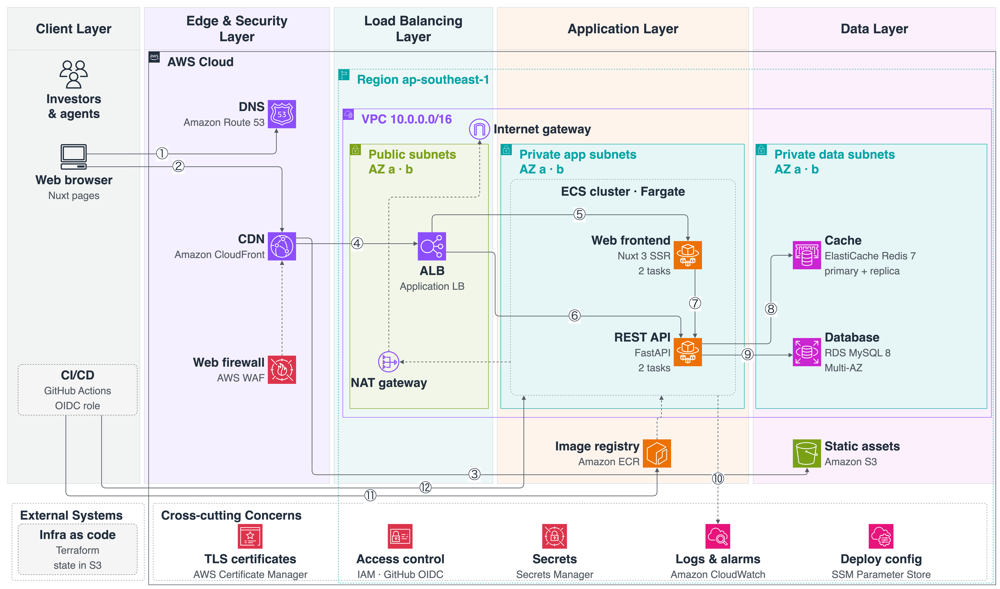

# Real Estate Investment Portal

An international real estate investment web platform where investors can search listings, save favourites and contact agents, and agents can manage their listings.

- **Backend:** Python 3.12 · FastAPI · SQLAlchemy 2 (async) · MySQL 8 · Redis 7
- **Frontend:** Nuxt 4 (Vue 3, TypeScript, SSR) · Pinia · SCSS design tokens
- **Infra:** Docker / docker-compose locally · Terraform for AWS (ECS Fargate, RDS, ElastiCache, CloudFront)
- **Mobile:** Flutter is planned later. The versioned REST API is ready for it.

> Status: **backend and web app built and tested** (53 API tests, 96 % coverage · 27 web tests). Both Docker
> images build and run together (`docker compose up`, verified). AWS infrastructure code is written and
> validated (`tofu validate`, Checkov) but not applied to a real account — see [plan §15](docs/plan.md#15-aws-deployment)
> and [§16](docs/plan.md#16-implementation-notes-built-vs-planned). The full plan is in [`docs/plan.md`](docs/plan.md).

---

## Requirements

### Functional requirements

| ID | Requirement |
|---|---|
| FR-01 | Home page with hero search, featured and latest listings, top cities |
| FR-02 | Search by purpose (sale/rent), type, location, price, bedrooms and area, with sort and pagination |
| FR-03 | Listing detail: gallery, facts, amenities, agent card, similar listings |
| FR-04 | Shareable URLs for listings and searches (filters in the query string) |
| FR-05 | Register / login / logout as investor or agent |
| FR-06 | Favourites (watchlist) |
| FR-07 | Send an inquiry about a listing |
| FR-08 | Agents create, edit, publish and delete their own listings |
| FR-09 | Agents see and update inquiries on their listings |
| FR-10 | Prices shown in a chosen currency |
| FR-11 | Admin moderation (API only) |
| FR-12 | Listings are indexable by search engines |

### Non-functional requirements

| ID | Quality | Target |
|---|---|---|
| NFR-01 | Performance | API p95 < 300 ms (cached < 50 ms), page LCP < 2.5 s |
| NFR-02 | SEO | SSR, meta + JSON-LD + sitemap, Lighthouse SEO ≥ 90 |
| NFR-03 | Scalability | Stateless app tiers that scale horizontally, with a cache for hot reads |
| NFR-04 | Availability | 99.9 % in production: 2 AZs, Multi-AZ DB, zero-downtime deploys |
| NFR-05 | Security | OWASP Top 10, JWT + revocation, role/ownership checks, rate limits, private data tier |
| NFR-06 | Data integrity | `DECIMAL` money, transactions, FK constraints, migrations, backups |
| NFR-07 | Maintainability | Layered modules, no magic strings, strict lint and type checks |
| NFR-08 | Testability | ≥ 80 % coverage on business logic, plus an E2E happy path |
| NFR-09 | Observability | JSON logs with request-id, health checks, dashboards and alarms |
| NFR-10 | Deployability | `make up` locally, one command or one merge to deploy, rollback < 5 min |
| NFR-11 | Extensibility | Versioned OpenAPI contract, ready for a mobile client and i18n |
| NFR-12 | Accessibility | Responsive from 360 px, WCAG 2.1 AA |
| NFR-13 | Cost | Staging ≈ USD 150/month (EC2 budget option ≈ USD 21), budget alert, can be destroyed and recreated from code |

## Design standards (derived from the requirements)

| ID | Standard | Serves |
|---|---|---|
| DS-01 | Layered architecture: router → service → repository → model | NFR-07, NFR-08 |
| DS-02 | Explicit contracts: Pydantic DTOs, generated TS types, one response envelope | NFR-07, NFR-11 |
| DS-03 | No magic values: enums, constants and design tokens | NFR-07 |
| DS-04 | Stateless services: state only in MySQL / Redis / S3 | NFR-03, NFR-04 |
| DS-05 | Cache-aside with explicit invalidation | NFR-01, NFR-03 |
| DS-06 | SSR for public pages, CSR for the dashboard | NFR-02, NFR-01 |
| DS-07 | Security by default: deny unless authorised, validate, rate-limit, secrets out of code | NFR-05 |
| DS-08 | Unit of Work transactions, Alembic migrations, expand/contract | NFR-06, NFR-10 |
| DS-09 | Test pyramid, and every bug fix gets a regression test | NFR-08 |
| DS-10 | Observable by default: request-id, structured logs, `/health` | NFR-09 |
| DS-11 | Everything as code: Docker, Terraform, CI/CD, diagrams | NFR-10, NFR-13 |
| DS-12 | Accessible, token-based base components | NFR-12 |
| DS-13 | Versioned API, additive changes within a version | NFR-11 |

The full traceability matrix (requirement → standard → architecture decision) is in [`plan.md` §2A](docs/plan.md#2a-requirements--design-standards--decisions).

---

## Architecture

**Application:** Nuxt 4 SSR → FastAPI (`/api/v1`) → service → repository → MySQL, with Redis for cache, rate limiting and token revocation. See [`plan.md` §4–§7](docs/plan.md#4-architecture).

**AWS deployment:** CloudFront + WAF → ALB → ECS Fargate (Nuxt SSR, FastAPI) → RDS MySQL and ElastiCache Redis in private subnets across 2 AZs, with static assets on S3. See [`plan.md` §15](docs/plan.md#15-aws-deployment).



The diagram source is generated from code: `python3 docs/architecture/gen_aws_diagram.py` → `docs/architecture/aws_architecture.drawio` (open it in app.diagrams.net and export it as PNG).

| # | Flow |
|---|---|
| ① ② | Browser resolves DNS (Route 53) and connects over HTTPS to CloudFront (WAF) |
| ③ | CloudFront serves hashed assets and images from S3 |
| ④ ⑤ ⑥ | CloudFront → ALB → Nuxt SSR (`/*`) or FastAPI (`/api/*`) |
| ⑦ | Nuxt SSR calls FastAPI inside the VPC (ECS Service Connect) |
| ⑧ ⑨ | FastAPI uses Redis (cache, rate limit, revocation) and RDS MySQL |
| ⑩ | Logs and metrics go to CloudWatch |
| ⑪ ⑫ | GitHub Actions (OIDC) pushes images to ECR, runs migrations and deploys to ECS |

### Business flows

One overview diagram per core flow (generated by `docs/architecture/gen_business_flows.py`). The rules and error codes behind each flow are in [`plan.md` §7A](docs/plan.md#7a-business-flows-one-overview-per-flow).

| Flow | Diagram |
|---|---|
| B1 Search listings (FR-02, FR-04, FR-10) | [view](docs/architecture/flow_b1_search_listings.png) |
| B2 View listing with SSR and SEO (FR-03, FR-12) | [view](docs/architecture/flow_b2_view_listing_ssr_seo.png) |
| B3 Login and session (FR-05) | [view](docs/architecture/flow_b3_login_session.png) |
| B4 Favourites (FR-06) | [view](docs/architecture/flow_b4_favourites.png) |
| B5 Send inquiry to agent (FR-07, FR-09) | [view](docs/architecture/flow_b5_send_inquiry.png) |
| B6 Listing lifecycle (FR-08) | [view](docs/architecture/flow_b6_listing_lifecycle.png) |


---

## Getting started

Demo accounts (after seeding), password `Demo@1234`: `investor@demo.com`, `agent@demo.com`, `agent2@demo.com`, `admin@demo.com`.

### With Docker

```bash
cp .env.example .env
make up                      # MySQL, Redis, API :8000 (migrates on start), web :3000
make seed                    # demo data; `make seed ARGS=--reset` to recreate
```

### Without Docker (MySQL 8+ and Redis 7 running locally)

```bash
# API
cd backend
python3 -m venv .venv && .venv/bin/pip install -r requirements.txt -e ".[dev]"
cp .env.example .env                        # DATABASE_URL, REDIS_URL, JWT_SECRET
.venv/bin/alembic upgrade head && .venv/bin/python -m scripts.seed
.venv/bin/uvicorn app.main:app --reload --port 8000

# Web (second terminal)
cd frontend
npm install
npm run dev                                 # http://localhost:3000, proxies /api/v1 to :8000
```

- Web: <http://localhost:3000>
- API docs (Swagger): <http://localhost:8000/docs>

## Quality checks

```bash
make lint        # ruff + ESLint
make typecheck   # mypy --strict + vue-tsc
make test        # pytest (SQLite + fakeredis, no services needed) + Vitest
```

CI (`.github/workflows/ci.yml`) runs the same checks on every pull request, with an 80 % backend coverage gate, then builds both Docker images.

## Deploying to AWS

The architecture, Terraform modules and deploy scripts are in `infra/terraform/` and `scripts/aws/`
(design in [plan §15](docs/plan.md#15-aws-deployment); deviations from the plan in [§16](docs/plan.md#16-implementation-notes-built-vs-planned)).
They validate cleanly (`tofu validate`, Checkov) but have not been applied to a real AWS account —
no account is available in this environment.

```bash
make aws-bootstrap                          # once per account: Terraform state bucket
make infra-plan ENV=staging                 # review the plan
make infra-apply ENV=staging                # provision the environment
make deploy ENV=staging                     # build → push → migrate → release → smoke test
make aws-seed                               # demo data on staging
make rollback ENV=staging                   # previous task definition
```

Security posture and the trade-offs accepted for this assignment (KMS keys, access logging, …) are in
[`infra/terraform/SECURITY_NOTES.md`](infra/terraform/SECURITY_NOTES.md).

## Project documents

- [`docs/plan.md`](docs/plan.md): scope, requirements, design, work breakdown, AI workflow, AWS deployment
- [`docs/architecture/`](docs/architecture/): AWS diagram and business flow diagrams (generated from code)
