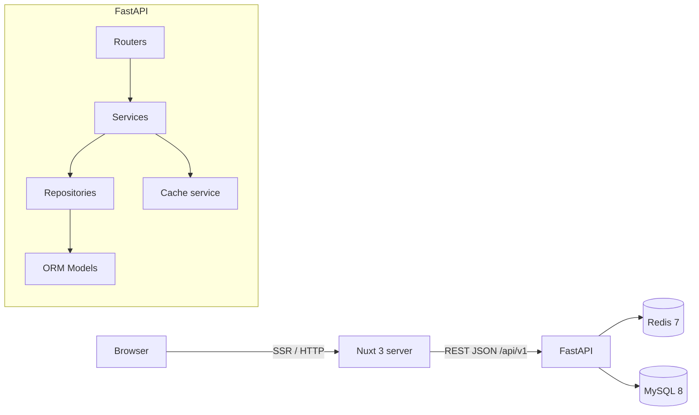
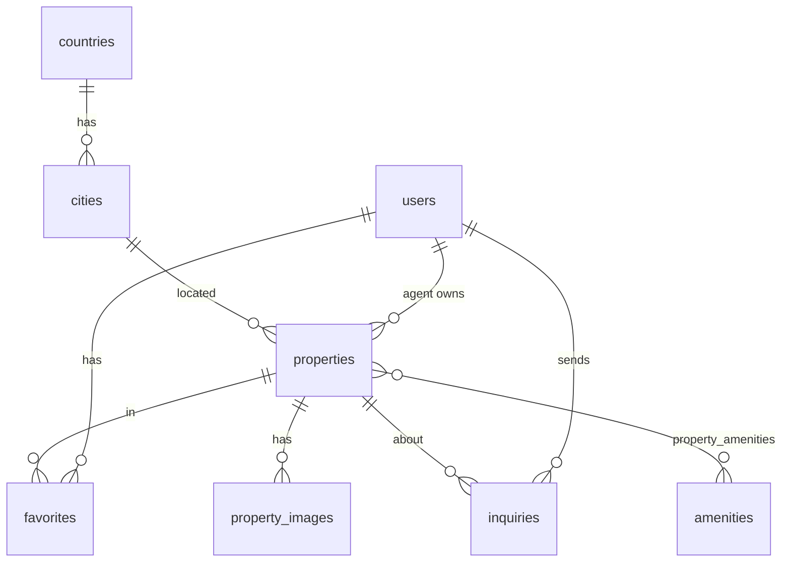
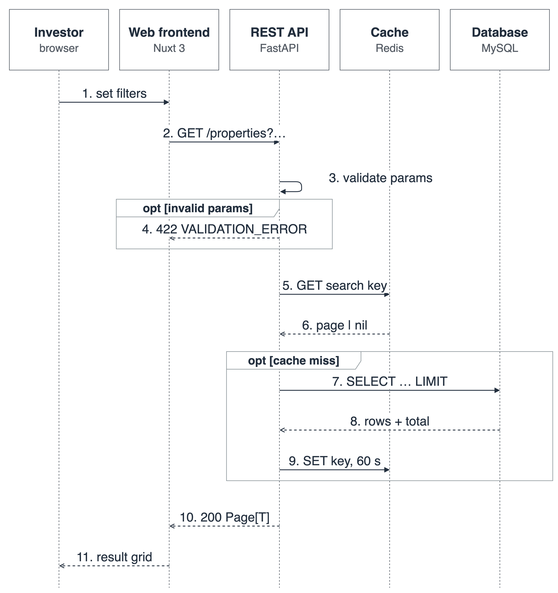
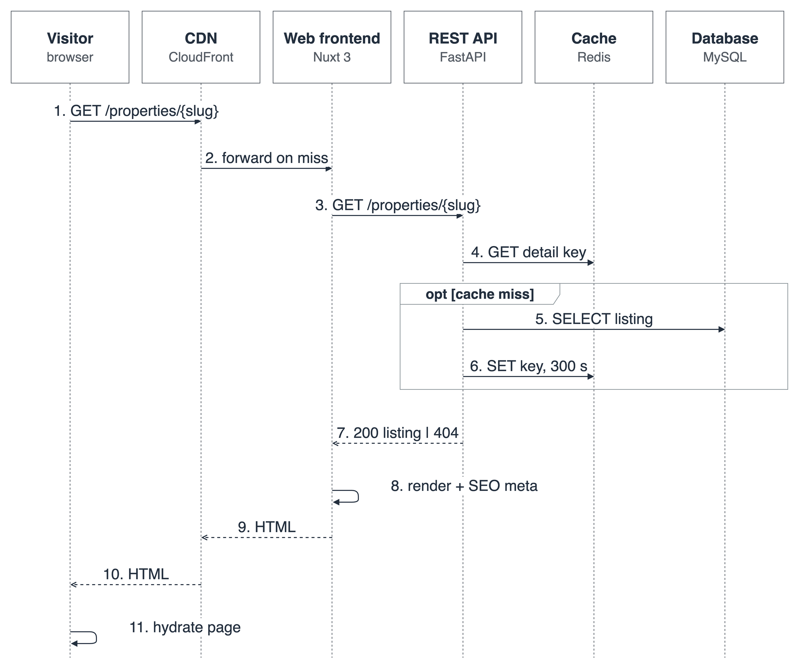
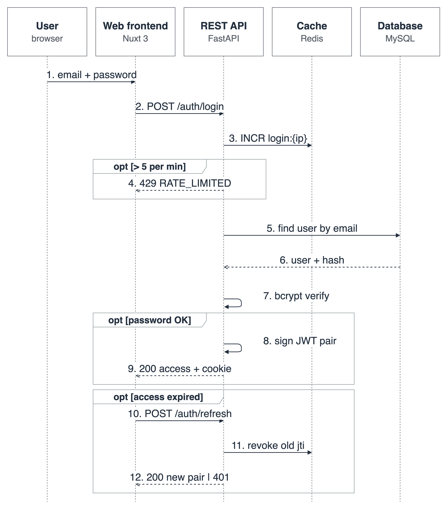
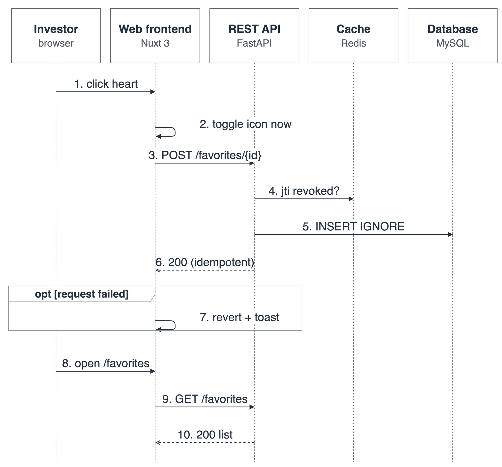
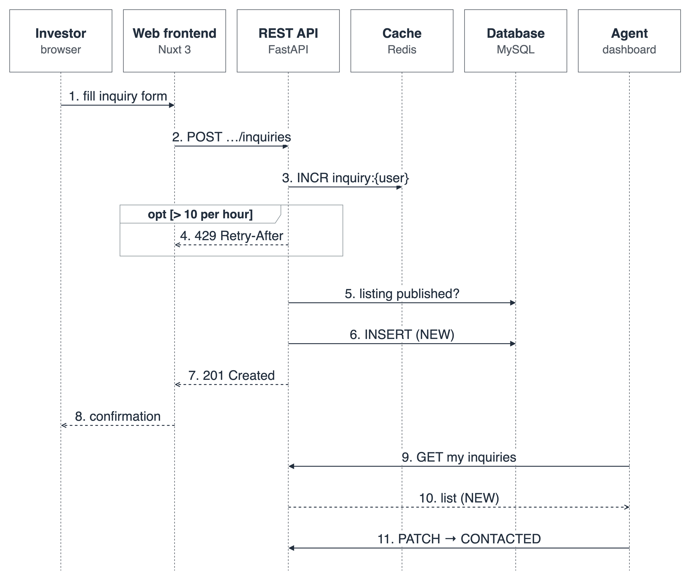
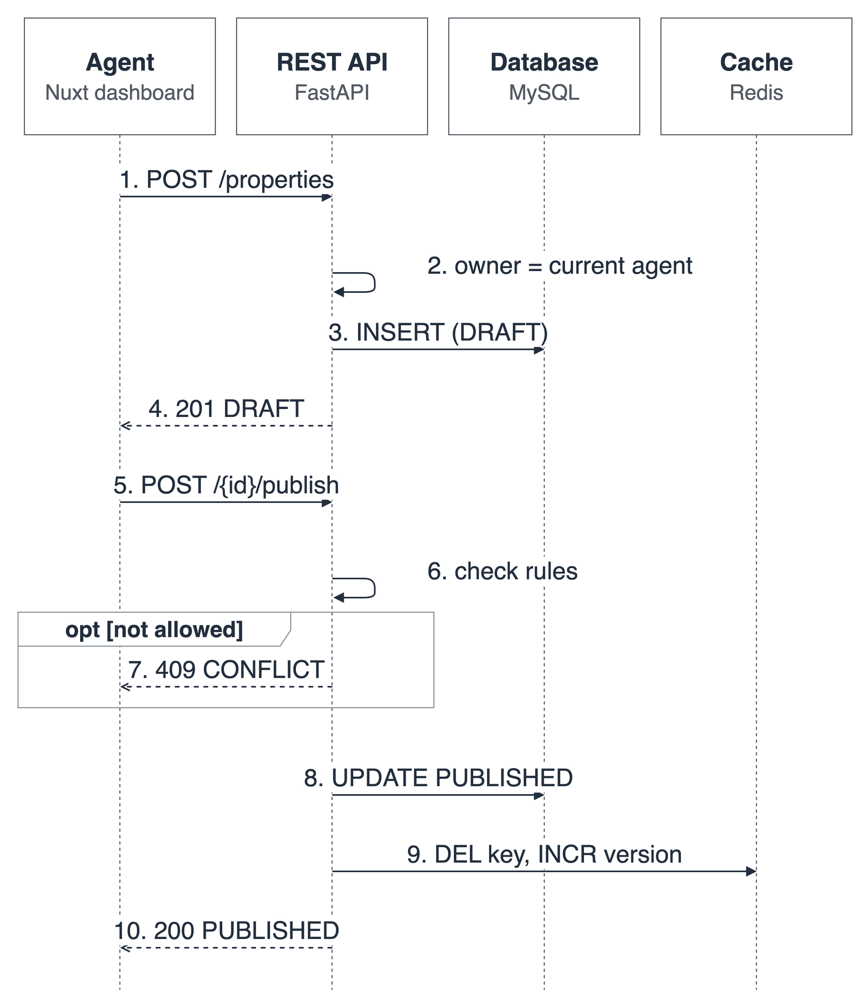
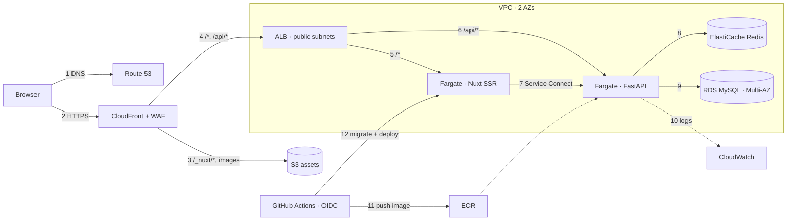
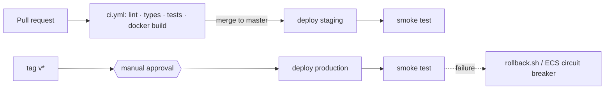

# Real Estate Investment Portal — Project Plan

> Home assignment: an **international real estate investment** web platform.
> Backend: **Python / FastAPI + MySQL + Redis**, all in **Docker**.
> Frontend: **Nuxt 3 (Vue 3)**, with SSR for SEO.
> UI reference: <https://sheltos-vue.vercel.app/>
> Flutter mobile is **out of scope for now**. The API is designed so it can serve a mobile client later without changes.

---

## 1. Goals of this assignment

The code should show what the job description asks for:

| Job requirement | How this project shows it |
|---|---|
| Turn project plans into small, clear work items | §10 splits the work into small tickets, each with acceptance criteria |
| Guide the AI and keep the process on track | §11 covers the AI workflow, prompts and review checklist, and each PR has an "AI-assisted" note |
| Review and test the generated code | pytest + Vitest, lint, type-check and CI gates (§9) |
| Verify work before calling it done | Definition of Done (§12) |
| Clear written English | README, ADRs, OpenAPI docs and commit messages |
| Production mindset | AWS architecture, IaC (Terraform), scripted deploy with migrations, smoke tests and rollback (§15) |

**Main aim: clean, explicit, easy-to-read code**, with visible layers, a named design pattern for each concern, no magic strings (enums and constants everywhere), and one source of truth for colours and design tokens.

---

## 2. Product scope (MVP)

### Personas
- **Visitor (guest):** browses and searches listings and views details.
- **Investor (registered user):** saves favourites and sends inquiries to agents.
- **Agent:** creates, edits and publishes their own listings and sees inquiries for them.
- **Admin:** moderates listings and manages users (small, API-only in the MVP).

### Features: in scope
| # | Feature | Notes |
|---|---|---|
| F1 | Home page | Hero search, featured properties, latest listings, cities, stats |
| F2 | Property search and listing | Filters: purpose (sale/rent), type, country/city, price range, bedrooms, area; sort; pagination |
| F3 | Property detail | Gallery, key facts, amenities, map placeholder, agent card, inquiry form, similar properties |
| F4 | Authentication | Register, login, JWT access + refresh tokens, logout (refresh token revoked in Redis) |
| F5 | Favourites / watchlist | Add or remove, and "My favourites" page |
| F6 | Inquiries | Investor sends a message about a property, and the agent sees a list with status |
| F7 | Agent dashboard | CRUD for own listings, image URLs, publish/unpublish |
| F8 | Multi-currency display | Price stored in the listing currency, shown in a chosen currency (static FX table, cached) |
| F9 | SEO | SSR, `useSeoMeta`, schema.org JSON-LD for `RealEstateListing`, sitemap |

### Out of scope (documented as "next steps")
Flutter app, real payments, image upload to S3 (image URLs only for now), real maps API, chat, i18n beyond EN (the structure is ready for it).

---

## 2A. Requirements → design standards → decisions

Every architecture and coding choice in this plan traces back to a requirement.
The chain is **requirement (FR/NFR) → design standard (DS) → decision**, and the traceability matrix in §2A.4 is how a reviewer checks that nothing was added "because it looks senior".

### 2A.1 Functional requirements (FR)

| ID | Requirement | Actor | Priority |
|---|---|---|---|
| FR-01 | Browse the home page: hero search, featured listings, latest listings, top cities | Visitor | Must |
| FR-02 | Search listings by purpose (sale/rent), type, country/city, price range, bedrooms and area; sort; paginate | Visitor | Must |
| FR-03 | View a listing: gallery, key facts, amenities, description, agent card, similar listings | Visitor | Must |
| FR-04 | Share a listing and its search results by URL (filters are kept in the query string) | Visitor | Must |
| FR-05 | Register and log in as an investor or an agent; log out; stay logged in (refresh token) | Visitor | Must |
| FR-06 | Save and remove favourites, and see the "My favourites" list | Investor | Must |
| FR-07 | Send an inquiry about a listing | Investor | Must |
| FR-08 | Create, edit, publish/unpublish and delete own listings | Agent | Must |
| FR-09 | See inquiries on own listings and change their status | Agent | Must |
| FR-10 | Show prices in a chosen currency (USD, EUR, GBP, VND, AED, SGD) | Visitor | Should |
| FR-11 | Moderate listings and deactivate users (API only) | Admin | Could |
| FR-12 | Listings appear in search engines with a correct title, description and structured data | Business | Must |

### 2A.2 Non-functional requirements (NFR)

Targets are set for the assignment's scale (seed data plus a small demo audience) and are measurable.

| ID | Quality | Requirement (measurable) |
|---|---|---|
| NFR-01 | Performance | API p95 < 300 ms for search/detail at 50 req/s (cached p95 < 50 ms), and home and detail pages LCP < 2.5 s on 4G |
| NFR-02 | SEO | Public pages are server-rendered with unique `<title>`/meta, JSON-LD and sitemap, and Lighthouse SEO ≥ 90 |
| NFR-03 | Scalability | App tiers are stateless (no session in memory), so capacity scales by adding containers. Heavy reads are cached |
| NFR-04 | Availability | Production target 99.9 %: two or more tasks per service across 2 AZs, Multi-AZ DB, health checks, zero-downtime rolling deploys |
| NFR-05 | Security | OWASP Top 10 covered: hashed passwords (bcrypt), short-lived JWT + revocable refresh, role and ownership checks on every write, validated input, rate limits, no secrets in code or images, TLS everywhere, private DB/cache |
| NFR-06 | Data integrity | Money stored as `DECIMAL`, one transaction per use case, FK constraints, versioned migrations, daily DB backups (7–14 days) |
| NFR-07 | Maintainability | Layered, feature-first modules; no magic strings; ruff/mypy strict and ESLint/vue-tsc clean; a new filter or entity touches ≤ 1 module per layer |
| NFR-08 | Testability | ≥ 80 % coverage on services/repositories, each business rule has a unit test, and the main user journey has an E2E test |
| NFR-09 | Observability | Structured JSON logs with request-id, health endpoint, CloudWatch dashboards and alarms (5xx, latency, CPU, DB connections) |
| NFR-10 | Deployability | One command locally (`make up`), one command or one merge to deploy (`make deploy` / CI), rollback < 5 min, infrastructure as code |
| NFR-11 | Portability & extensibility | A versioned REST API (`/api/v1`) with an OpenAPI contract, so a Flutter app can be added without backend changes. Structure ready for i18n |
| NFR-12 | Usability & accessibility | Responsive from 360 px, WCAG 2.1 AA contrast and keyboard navigation, loading/empty/error states on every data view |
| NFR-13 | Cost | Staging runs at about USD 150/month or less (§15.10; EC2 budget option ≈ USD 21), with a budget alert, and the environment can be destroyed and recreated from code |

### 2A.3 Design standards (DS) derived from the requirements

| ID | Design standard (the rule every change must follow) | Derived from |
|---|---|---|
| DS-01 | **Layered architecture:** router → service → repository → model. Routers hold no business logic, and services do not know about HTTP | NFR-07, NFR-08 |
| DS-02 | **Explicit contracts:** Pydantic DTOs at the API boundary, OpenAPI-generated TS types on the FE, and a standard response/error envelope | NFR-07, NFR-11 |
| DS-03 | **No magic values:** enums for every closed set, constants for limits and TTLs, and design tokens for every colour and spacing value | NFR-07 |
| DS-04 | **Stateless services:** state lives only in MySQL/Redis/S3, and auth uses JWT | NFR-03, NFR-04 |
| DS-05 | **Cache-aside with explicit invalidation** for read-heavy endpoints, with keys built in one module | NFR-01, NFR-03 |
| DS-06 | **SSR for public pages, CSR for the dashboard** | NFR-02, NFR-01 |
| DS-07 | **Security by default:** deny unless the role and ownership check passes, validate all input, rate-limit auth and write endpoints, keep secrets only in env/Secrets Manager | NFR-05 |
| DS-08 | **Transactions via Unit of Work,** money as `DECIMAL`, migrations only through Alembic, and expand/contract for breaking schema changes | NFR-06, NFR-10 |
| DS-09 | **Test pyramid:** unit tests on services with fake repositories, integration tests on real MySQL/Redis, 1–2 E2E tests. Every bug fix gets a regression test | NFR-08 |
| DS-10 | **Observable by default:** request-id middleware, structured logs, `/health`, and no silent `except` | NFR-09 |
| DS-11 | **Everything as code:** Dockerfiles, docker-compose, Terraform, CI/CD, and diagrams generated from scripts | NFR-10, NFR-13 |
| DS-12 | **Accessible, token-based UI components:** Base components own a11y (labels, focus, contrast), and pages compose them | NFR-12 |
| DS-13 | **API versioning and backward compatibility:** `/api/v1`, additive changes only within a version | NFR-11 |

### 2A.4 Traceability: requirement → decision

| Decision (section) | Why (FR/NFR → DS) |
|---|---|
| FastAPI + Pydantic v2 (§3, §6) | Typed contracts and OpenAPI for free → NFR-07, NFR-11 / DS-02 |
| Nuxt 3 with SSR route rules (§7.1) | FR-12, NFR-02 / DS-06 |
| Filters kept in the URL query (§7.2) | FR-04 |
| Repository + Unit of Work + DI (§6.2) | NFR-06, NFR-08 / DS-01, DS-08 |
| `PropertyFilter` specification object (§6.2) | FR-02, NFR-07 (a new filter is one class change) |
| Redis cache-aside + version-counter invalidation (§6.7) | NFR-01, NFR-03 / DS-05 |
| Redis rate limiting + refresh-token revocation (§6.7) | FR-05, NFR-05 / DS-07 |
| `DECIMAL` price + `Currency` enum + converter Strategy (§6.3, §6.5) | FR-10, NFR-06 / DS-03, DS-08 |
| Enums/constants/design tokens (§6.3, §6.4, §7.5) | NFR-07, NFR-12 / DS-03, DS-12 |
| ECS Fargate, 2 AZs, ALB health checks, rolling deploy (§15) | NFR-03, NFR-04, NFR-10 / DS-04, DS-11 |
| CloudFront + S3 for static assets (§15) | NFR-01, NFR-02 |
| Private subnets, Secrets Manager, WAF, OIDC (§15.4) | NFR-05 / DS-07 |
| Terraform + scripted deploy + rollback (§15.6–15.7) | NFR-10, NFR-13 / DS-11 |
| CloudWatch logs, dashboards and alarms (§15.9) | NFR-09 / DS-10 |

**How to use this in code review:** each PR description names the FR/NFR it serves and the DS it follows.
A change that breaks a DS needs an ADR in `docs/adr/` explaining the exception.

---

## 3. Tech stack

| Layer | Choice | Why |
|---|---|---|
| API | FastAPI (Python 3.12), Uvicorn | Async, typed, OpenAPI generated automatically |
| Validation / DTO | Pydantic v2, pydantic-settings | Explicit request and response contracts |
| ORM / migrations | SQLAlchemy 2.0 (async) + Alembic | Typed `Mapped[]` models and versioned schema |
| DB | MySQL 8 (`asyncmy` driver) | Required |
| Cache / rate limiting / token revocation | Redis 7 | Required |
| Auth | JWT (`pyjwt`), `passlib[bcrypt]` | Stateless API, ready for mobile |
| Tests | pytest, pytest-asyncio, httpx `AsyncClient`, factory-boy | |
| Quality | ruff (lint + format), mypy (strict), pre-commit | |
| Frontend | Nuxt 3, Vue 3 `<script setup lang="ts">`, TypeScript strict | SSR/SEO matters for property sales pages |
| State | Pinia | |
| Styling | SCSS design tokens + CSS variables (no UI kit lock-in) | Full control to match the Sheltos look |
| FE tests | Vitest + @vue/test-utils, Playwright (1–2 smoke E2E tests) | |
| FE quality | ESLint (`@nuxt/eslint`), Prettier, `vue-tsc` | |
| API types | `openapi-typescript` generates TS types from FastAPI's OpenAPI | Keeps the FE and BE contracts in sync |
| Infra | Docker, docker-compose, Makefile, GitHub Actions CI | |

---

## 4. Architecture



**Request flow (backend):**
`Router` (HTTP only) → `Service` (business rules) → `Repository` (data access) → `SQLAlchemy model`.
Pydantic **schemas** are the only objects that cross the HTTP boundary. ORM models never leave the service layer.

---

## 5. Repository layout

```
python-vuejs/
├── README.md
├── docker-compose.yml
├── Makefile                  # make up / down / test / lint / migrate / seed / deploy …
├── .env.example
├── .github/workflows/
│   ├── ci.yml                # lint + type-check + tests on every PR
│   └── deploy.yml            # master → staging, tag v* → production (§15.8)
├── docs/
│   ├── plan.md               # this file
│   ├── adr/                  # Architecture Decision Records (0001-layered-architecture.md …)
│   ├── architecture/         # AWS diagram as code + generated PNG (§15.2)
│   └── screenshots/
├── infra/terraform/          # AWS infrastructure as code (§15.6)
├── scripts/aws/              # deploy / migrate / rollback scripts (§15.7)
├── backend/
└── frontend/
```

---

## 6. Backend design (FastAPI)

### 6.1 Folder structure

```
backend/
├── Dockerfile
├── pyproject.toml
├── alembic.ini
├── alembic/versions/
├── app/
│   ├── main.py                     # app factory: create_app()
│   ├── core/
│   │   ├── config.py               # Settings (pydantic-settings), singleton via lru_cache
│   │   ├── security.py             # hash/verify password, create/decode JWT
│   │   ├── exceptions.py           # AppException hierarchy
│   │   ├── exception_handlers.py   # maps AppException → JSON error envelope
│   │   ├── logging.py              # structured JSON logging + request id
│   │   └── middleware.py           # request-id, timing, CORS
│   ├── common/
│   │   ├── enums.py                # ALL enums (see 6.3)
│   │   ├── constants.py            # ALL constants (see 6.4)
│   │   ├── pagination.py           # PageParams, Page[T] generic
│   │   └── responses.py            # ApiResponse[T], ErrorResponse
│   ├── db/
│   │   ├── base.py                 # DeclarativeBase, TimestampMixin, SoftDeleteMixin
│   │   ├── session.py              # async engine + session factory
│   │   └── unit_of_work.py         # UnitOfWork (commit/rollback boundary)
│   ├── cache/
│   │   ├── redis_client.py
│   │   ├── cache_service.py        # get/set/invalidate, JSON serialisation
│   │   ├── keys.py                 # CacheKey builder, no inline key strings
│   │   └── rate_limiter.py
│   ├── modules/                    # feature-first, each module is self-contained
│   │   ├── auth/      {router.py, service.py, schemas.py, dependencies.py}
│   │   ├── users/     {router.py, service.py, repository.py, models.py, schemas.py}
│   │   ├── properties/{router.py, service.py, repository.py, models.py, schemas.py, filters.py}
│   │   ├── locations/ {…}          # countries, cities
│   │   ├── amenities/ {…}
│   │   ├── favorites/ {…}
│   │   ├── inquiries/ {…}
│   │   └── currency/  {service.py, rates.py}   # Strategy for price conversion
│   ├── repositories/base.py        # BaseRepository[ModelT] generic CRUD
│   └── api/
│       ├── deps.py                 # get_db, get_uow, get_current_user, require_role(...)
│       └── v1/router.py            # includes all module routers under /api/v1
├── scripts/seed.py                 # demo data: 40+ properties, 3 agents, demo accounts
└── tests/
    ├── conftest.py                 # test DB, client, factories
    ├── unit/                       # services with fake repositories
    └── integration/                # API endpoints against MySQL + Redis in Docker
```

### 6.2 Design patterns (each one used for a clear reason)

| Pattern | Where | Purpose |
|---|---|---|
| **Layered / Clean architecture** | router → service → repository | Separation of concerns and testability |
| **Repository** | `BaseRepository[T]`, `PropertyRepository` | Keeps SQL out of business logic |
| **Unit of Work** | `db/unit_of_work.py` | One transaction per use case, explicit commit |
| **Dependency Injection** | FastAPI `Depends` in `api/deps.py` | Swap in real or fake dependencies in tests |
| **DTO** | Pydantic `*Create`, `*Update`, `*Read` schemas | Explicit API contracts, never expose ORM models |
| **Specification / Filter object** | `properties/filters.py` → `PropertyFilter.apply(query)` | Search filters stay composable and readable |
| **Cache-Aside** | `CacheService` in property and currency services | Faster reads, explicit invalidation on write |
| **Strategy** | `CurrencyConverter` (static table now, API later) | Swappable implementation behind an interface |
| **Factory** | `create_app()`, test factories (factory-boy) | Configurable app and test data |
| **Singleton (via DI)** | `get_settings()` with `lru_cache`, Redis pool | One config and one connection pool |
| **Generic types** | `Page[T]`, `ApiResponse[T]` | One response envelope for all endpoints |
| **Exception hierarchy** | `AppException → NotFoundError, ConflictError, ForbiddenError, ValidationError` | Consistent error JSON, no `HTTPException` inside services |
| **Mixins** | `TimestampMixin`, `SoftDeleteMixin` | Shared columns in one place |

### 6.3 Enums (`app/common/enums.py`)

All are `StrEnum`, stored as strings in MySQL and mirrored in the frontend (§7.4).

```python
class UserRole(StrEnum):        INVESTOR, AGENT, ADMIN
class ListingPurpose(StrEnum):  SALE, RENT
class PropertyType(StrEnum):    APARTMENT, HOUSE, VILLA, OFFICE, LAND, COMMERCIAL
class PropertyStatus(StrEnum):  DRAFT, PUBLISHED, SOLD, RENTED, ARCHIVED
class Currency(StrEnum):        USD, EUR, GBP, VND, AED, SGD
class AreaUnit(StrEnum):        SQM, SQFT
class InquiryStatus(StrEnum):   NEW, CONTACTED, CLOSED
class PropertySort(StrEnum):    NEWEST, PRICE_ASC, PRICE_DESC, AREA_DESC
class ErrorCode(StrEnum):       NOT_FOUND, VALIDATION_ERROR, UNAUTHORIZED, FORBIDDEN,
                                CONFLICT, RATE_LIMITED, INTERNAL_ERROR
```

### 6.4 Constants (`app/common/constants.py`)

```python
API_V1_PREFIX = "/api/v1"
DEFAULT_PAGE_SIZE = 12
MAX_PAGE_SIZE = 50
ACCESS_TOKEN_TTL_MINUTES = 15
REFRESH_TOKEN_TTL_DAYS = 7
CACHE_TTL_PROPERTY_DETAIL_SECONDS = 300
CACHE_TTL_SEARCH_SECONDS = 60
CACHE_TTL_FEATURED_SECONDS = 600
RATE_LIMIT_LOGIN_PER_MINUTE = 5
RATE_LIMIT_INQUIRY_PER_HOUR = 10
MAX_IMAGES_PER_PROPERTY = 15
SLUG_MAX_LENGTH = 180
```

Secrets and environment-specific values live in `.env` → `Settings`, never in constants.

### 6.5 Data model (MySQL)



| Table | Key columns |
|---|---|
| `users` | id, email (unique), hashed_password, full_name, phone, role, avatar_url, is_active, created_at, updated_at |
| `countries` | id, code (ISO-2, unique), name |
| `cities` | id, country_id, name, slug |
| `properties` | id, slug (unique), title, description, purpose, type, status, price (DECIMAL 15,2), currency, area, area_unit, bedrooms, bathrooms, year_built, address, city_id, lat, lng, is_featured, agent_id, published_at, deleted_at, timestamps |
| `property_images` | id, property_id, url, sort_order, is_cover |
| `amenities` | id, code, name, icon |
| `property_amenities` | property_id, amenity_id (composite PK) |
| `favorites` | user_id, property_id (composite PK), created_at |
| `inquiries` | id, property_id, user_id, message, phone, status, created_at |

**Indexes:** `(status, purpose, type, city_id, price)` for search, `(agent_id, status)`, `slug`, `(is_featured, published_at)`.
Money is always `DECIMAL`, never float.

### 6.6 REST API (`/api/v1`)

| Method | Path | Auth | Description |
|---|---|---|---|
| POST | `/auth/register` | – | Register (role INVESTOR or AGENT) |
| POST | `/auth/login` | – | Access token in the body, refresh token in an httpOnly cookie (rate limited) |
| POST | `/auth/refresh` | refresh cookie | Rotate the pair and revoke the old `jti` |
| POST | `/auth/logout` | user | Revoke refresh token (Redis) |
| GET | `/users/me` | user | Current profile |
| GET | `/properties` | – | Search with filters, sort and pagination (cached) |
| GET | `/properties/featured` | – | Featured list (cached) |
| GET | `/properties/{slug}` | – | Detail (cached) |
| GET | `/properties/{slug}/similar` | – | Same city/type, similar price |
| POST | `/properties` | agent | Create (status DRAFT) |
| PATCH | `/properties/{id}` | owner agent / admin | Update, invalidates cache |
| POST | `/properties/{id}/publish` | owner agent | DRAFT → PUBLISHED |
| DELETE | `/properties/{id}` | owner agent / admin | Soft delete |
| GET | `/agents/me/properties` | agent | Own listings, any status |
| GET / POST / DELETE | `/favorites`, `/favorites/{property_id}` | user | Watchlist |
| POST | `/properties/{id}/inquiries` | user | Send inquiry (rate limited) |
| GET | `/agents/me/inquiries` | agent | Inquiries on own listings |
| PATCH | `/inquiries/{id}` | owner agent | Update status |
| GET | `/locations/countries`, `/locations/cities?country=` | – | Lookups (cached) |
| GET | `/amenities` | – | Lookup (cached) |
| GET | `/currencies/rates` | – | FX table (cached) |
| GET | `/health` | – | DB + Redis health check |

**Response envelope:**
```json
{ "data": { }, "meta": { "page": 1, "size": 12, "total": 87, "pages": 8 } }
{ "error": { "code": "NOT_FOUND", "message": "Property not found", "details": null, "request_id": "…" } }
```

### 6.7 Redis usage
1. **Cache-aside:** `property:detail:{slug}`, `property:search:{hash(filters)}`, `property:featured`, `lookup:*`, `fx:rates`.
2. **Invalidation:** any write to a property deletes its detail key and bumps a `property:search:version` counter, which makes all search keys stale without a `KEYS` scan.
3. **Rate limiting:** fixed window with `INCR` + `EXPIRE` on login and inquiry.
4. **Token revocation:** `auth:revoked:{jti}` with TTL equal to the token's remaining lifetime.

All keys are built in `cache/keys.py`. No inline strings.

### 6.8 Backend testing
- **Unit:** services with in-memory fake repositories (permission rules, publish transitions, price conversion, filter building).
- **Integration:** real MySQL + Redis from docker-compose (`test` profile), httpx `AsyncClient`, one transaction per test with rollback.
- Target **≥ 80 % coverage** on `services` and `repositories`.
- Key cases: search filter combinations, pagination edges, agent A cannot edit agent B's listing, cache invalidated after update, rate limit returns 429, expired and revoked tokens.

---

## 7. Frontend design (Nuxt 3)

### 7.1 Why Nuxt
Property pages must be **indexable by Google and shareable** (sales and marketing). Nuxt gives SSR, per-page meta and file-based routing. Search pages render on the server, and the dashboard is client-side only (`ssr: false` route rule).

### 7.2 Pages (routes)

| Route | Render | Content |
|---|---|---|
| `/` | SSR | Hero + search bar, featured, latest, top cities, stats, CTA "List your property" |
| `/properties` | SSR | Filter sidebar, grid/list toggle, sort, pagination (filters kept in the URL query) |
| `/properties/[slug]` | SSR | Gallery, facts, amenities, description, agent card, inquiry form, similar |
| `/login`, `/register` | SSR | Auth forms with validation |
| `/favorites` | CSR, auth | Watchlist |
| `/dashboard` | CSR, agent | Stats + my listings table |
| `/dashboard/properties/new`, `/dashboard/properties/[id]/edit` | CSR, agent | Listing form |
| `/dashboard/inquiries` | CSR, agent | Inquiries table + status change |
| `/about`, `/contact` | SSR/static | Marketing |
| `error.vue` | – | 404/500 page |

### 7.3 Folder structure

```
frontend/
├── Dockerfile
├── nuxt.config.ts
├── app.vue
├── error.vue
├── assets/styles/
│   ├── _tokens.scss        # colours, spacing, radius, shadows, typography (single source)
│   ├── _mixins.scss        # breakpoints, truncate, etc.
│   └── main.scss           # CSS variables generated from tokens
├── constants/
│   ├── colors.ts           # COLORS object, same values as _tokens.scss
│   ├── api.ts              # API_ENDPOINTS
│   ├── routes.ts           # ROUTES
│   ├── app.ts              # PAGE_SIZE, DEBOUNCE_MS, DEFAULT_CURRENCY …
│   └── storage-keys.ts
├── enums/                  # mirror backend enums (PropertyType, ListingPurpose …)
│   └── index.ts
├── types/
│   ├── api.generated.ts    # generated with openapi-typescript (do not edit by hand)
│   └── models.ts           # front-end view models
├── services/               # Repository pattern on the FE
│   ├── http.ts             # $fetch wrapper: base URL, auth header, refresh, error mapping
│   ├── property.service.ts
│   ├── auth.service.ts
│   ├── favorite.service.ts
│   └── inquiry.service.ts
├── composables/            # reusable logic
│   ├── useProperties.ts    # search state ↔ URL query sync
│   ├── useAuth.ts
│   ├── useCurrency.ts      # format and convert (Intl.NumberFormat)
│   ├── useFavorites.ts
│   └── useSeo.ts           # meta + JSON-LD helpers
├── stores/                 # Pinia (global state only)
│   ├── auth.store.ts
│   ├── favorites.store.ts
│   └── preferences.store.ts   # currency, view mode
├── middleware/
│   ├── auth.ts
│   └── role.ts             # agent-only routes
├── components/
│   ├── base/               # dumb UI atoms: BaseButton, BaseInput, BaseSelect, BaseBadge, BaseModal, BasePagination, BaseSkeleton
│   ├── layout/             # AppHeader, AppFooter, AppBreadcrumb
│   ├── property/           # PropertyCard, PropertyGrid, PropertyFilters, PropertyGallery, PropertyFacts, PropertyPrice, PropertyStatusBadge
│   ├── home/               # HeroSearch, FeaturedSection, CityGrid, StatsBar
│   ├── agent/              # AgentCard, InquiryForm
│   └── dashboard/          # ListingForm, ListingTable, InquiryTable
├── layouts/
│   ├── default.vue
│   └── dashboard.vue
├── pages/ …                # see 7.2
├── utils/                  # pure functions: formatArea, buildQuery, slugify
└── tests/
    ├── unit/               # components + composables (Vitest)
    └── e2e/                # Playwright: search → detail → inquiry
```

### 7.4 Front-end patterns

| Pattern | Where | Purpose |
|---|---|---|
| **Container / Presentational** | pages fetch data, `components/base` and `property/*` only take props and emit events | Reusable UI that is easy to test |
| **Composables (hooks)** | `useProperties`, `useCurrency` | Share logic without mixins |
| **Repository / API service layer** | `services/*.service.ts` | Components never call `$fetch` directly |
| **Adapter / Mapper** | `services` map API DTO → view model | UI does not depend on the backend shape |
| **Centralised store** | Pinia, only for truly global state | Everything else stays local |
| **Route middleware (guard)** | `auth`, `role` | Access control in one place |
| **Design tokens** | `_tokens.scss` + `constants/colors.ts` | One source for colours and spacing |
| **Enums + constants** | `enums/`, `constants/` | No magic strings in templates |
| **Typed contracts** | `api.generated.ts` from OpenAPI | Compile-time errors when the API changes |

Enum example with labels for the UI:
```ts
export enum ListingPurpose { SALE = 'SALE', RENT = 'RENT' }
export const LISTING_PURPOSE_LABEL: Record<ListingPurpose, string> = {
  [ListingPurpose.SALE]: 'For Sale',
  [ListingPurpose.RENT]: 'For Rent',
}
```

### 7.5 Visual design (inspired by Sheltos)
- Clean white background, large hero image with a search bar over it, rounded cards with soft shadows, a coloured "For Sale / For Rent" badge on each card, bold price, and an icon row (bed / bath / area).
- **Colour tokens** (to be tuned against the reference site):

```scss
$color-primary:        #ff5c41;  // CTA, active states
$color-primary-dark:   #e0452b;
$color-secondary:      #1c2d3a;  // headings, footer
$color-accent:         #ff8c41;  // gradient partner for the primary
$color-success:        #3cba54;  // "For Rent" / published
$color-warning:        #f5a623;  // draft
$color-danger:         #e74c3c;
$color-text:           #586167;
$color-text-muted:     #8f98a0;
$color-border:         #eef0f2;
$color-bg:             #ffffff;
$color-bg-soft:        #f8f9fa;
$radius-sm: 4px; $radius-md: 8px; $radius-lg: 16px;
$shadow-card: 0 4px 20px rgba(28, 45, 58, .08);
$font-family: 'Montserrat', 'Segoe UI', sans-serif;
```

- Status → colour mapping is kept in one place (`PROPERTY_STATUS_COLOR`) and is never hard-coded in components.
- Responsive: mobile first, breakpoints at 576 / 768 / 992 / 1200 px.
- Accessibility: semantic HTML, alt text, focus states, AA contrast.

---

## 7A. Business flows (one overview per flow)

One UML sequence diagram per core business flow, in the same style as the thesis sequences S1–S7. Each participant is a column (user, Nuxt, FastAPI, Redis, MySQL …) and the steps are numbered 1 → n from top to bottom. A solid arrow is a call, a dashed arrow is a reply, and a loop is an internal step. An `opt [condition]` frame marks a step that only happens under that condition (error, cache miss, expired token …). Each flow names the requirements it implements (§2A), so a reviewer can go requirement → flow → code.

Source: `docs/architecture/gen_business_flows.py` → `business_flows.drawio` (pages B1–B6) → `flow_b1_search_listings.png` … `flow_b6_listing_lifecycle.png` (run with `--png`).

| Flow | Requirements | Key rules shown |
|---|---|---|
| B1 Search listings | FR-02, FR-04, FR-10, NFR-01 | Filters live in the URL, Pydantic validation → 422, cache-aside with version + hash key (TTL 60 s), page size ≤ 50 |
| B2 View listing (SSR + SEO) | FR-03, FR-12, NFR-02 | CloudFront short-TTL HTML cache, SSR with `useSeoMeta` + JSON-LD, detail cache (TTL 300 s), draft/deleted → 404 |
| B3 Login and session | FR-05, NFR-05 | Access 15 min, refresh 7 days in an httpOnly cookie, rotation on refresh, 5 logins/min/IP, logout revokes the `jti` |
| B4 Favourites | FR-06 | Optimistic toggle with revert on error, idempotent write (adding twice → 200), PK `(user_id, property_id)` |
| B5 Send inquiry | FR-07, FR-09 | Role INVESTOR, listing must be published, 10 inquiries/hour → 429 with `Retry-After`, agent status NEW → CONTACTED |
| B6 Listing lifecycle | FR-08, NFR-06 | Owner or admin only, state machine DRAFT → PUBLISHED → SOLD/RENTED → ARCHIVED, publish needs ≥ 1 image and a price, cache invalidation on every write |








Each flow becomes an integration test (§6.8) that walks the same path, e.g. B5: publish a listing → log in as an investor → post 11 inquiries → expect 201 × 10 then 429.

---

## 8. Docker & local development

`docker-compose.yml` services:

| Service | Image | Port | Notes |
|---|---|---|---|
| `mysql` | mysql:8.0 | 3306 | Named volume, healthcheck `mysqladmin ping` |
| `redis` | redis:7-alpine | 6379 | Healthcheck `redis-cli ping` |
| `backend` | ./backend (multi-stage, non-root) | 8000 | `depends_on` healthy DB/Redis, runs `alembic upgrade head` on start |
| `frontend` | ./frontend (multi-stage, node:20-alpine) | 3000 | `NUXT_PUBLIC_API_BASE` |

```bash
cp .env.example .env
make up        # build + start everything
make migrate   # alembic upgrade head
make seed      # demo data + demo accounts
make test      # backend + frontend tests
make lint      # ruff, mypy, eslint, vue-tsc
```

Demo accounts (seeded): `investor@demo.com`, `agent@demo.com`, `admin@demo.com` / `Demo@1234`.
API docs: `http://localhost:8000/docs`. Web: `http://localhost:3000`.

---

## 9. Code quality & conventions

- **Python:** ruff (lint + format), mypy strict, type hints everywhere, docstrings on public service methods, no business logic in routers, no `HTTPException` in services.
- **TypeScript/Vue:** `strict: true`, `<script setup lang="ts">`, typed `defineProps`/`defineEmits`, PascalCase component names, `use*` prefix for composables, no `any`.
- **Naming:** snake_case (Py), camelCase (TS), UPPER_SNAKE constants, singular table names only in models (plural table names in the DB).
- **Git:** Conventional Commits (`feat(properties): add price range filter`), one small PR per ticket, `pre-commit` hooks.
- **CI (GitHub Actions):** lint → type-check → tests (with MySQL/Redis service containers) → docker build.

---

## 10. Work breakdown (small tickets)

Each ticket is sized for about ½–1 day and has acceptance criteria (AC).

### Phase 0: Foundation (Day 1)
- **T0.1** Monorepo skeleton, `.env.example`, Makefile, README stub. *AC: `make up` starts 4 healthy containers.*
- **T0.2** Backend app factory, settings, logging, request-id middleware, `/health`. *AC: `/health` reports DB + Redis OK.*
- **T0.3** Error envelope, exception hierarchy, handlers. *AC: unknown route and raised `NotFoundError` both return the standard JSON.*
- **T0.4** CI pipeline + pre-commit. *AC: a PR runs lint and tests.*

### Phase 1: Data layer (Day 2)
- **T1.1** Enums and constants modules. *AC: no string literals for statuses/types anywhere else.*
- **T1.2** SQLAlchemy models, mixins, first Alembic migration. *AC: `alembic upgrade head` creates all tables and indexes.*
- **T1.3** `BaseRepository[T]`, Unit of Work, `Page[T]`. *AC: unit-tested generic CRUD + pagination.*
- **T1.4** Seed script. *AC: 40+ realistic international listings across ≥ 5 countries.*

### Phase 2: Core API (Days 3–4)
- **T2.1** Auth: register/login/refresh/logout + JWT + revocation. *AC: tests for expired, revoked and wrong-role tokens.*
- **T2.2** Property search with `PropertyFilter` + sort + pagination. *AC: each filter is covered by a test, and invalid values give 422.*
- **T2.3** Property detail, featured, similar. *AC: 404 for draft/deleted listings for non-owners.*
- **T2.4** Agent CRUD + publish + ownership rules. *AC: agent B gets 403 on agent A's listing.*
- **T2.5** Favourites + inquiries + agent inquiry list. *AC: duplicate favourite is idempotent.*
- **T2.6** Lookups (locations, amenities, currency rates).

### Phase 3: Redis (Day 5)
- **T3.1** CacheService + key builder + cache-aside on detail/search/featured/lookups. *AC: second request is served from cache (logged), and an update invalidates it.*
- **T3.2** Rate limiting on login and inquiry. *AC: 6th login in one minute returns 429 with `RATE_LIMITED`.*

### Phase 4: Frontend foundation (Day 6)
- **T4.1** Nuxt setup, ESLint/Prettier/vue-tsc, SCSS tokens, `constants/colors.ts`, enums. *AC: tokens used in a demo component, no hex values in components.*
- **T4.2** HTTP client + services + generated OpenAPI types. *AC: `npm run gen:api` regenerates types, and the build fails on contract drift.*
- **T4.3** Base components (Button, Input, Select, Badge, Pagination, Skeleton, Modal) + layout (Header, Footer).

### Phase 5: Frontend features (Days 7–9)
- **T5.1** Home page (hero search, featured, cities, stats).
- **T5.2** Listing page: filters ↔ URL query, sort, grid/list view, pagination, empty/loading/error states.
- **T5.3** Property detail: gallery, facts, amenities, agent card, inquiry form, similar, SEO meta + JSON-LD.
- **T5.4** Auth pages + `auth` store + token refresh + route middleware.
- **T5.5** Favourites (optimistic toggle on cards).
- **T5.6** Agent dashboard: listings table, create/edit form (validation), publish, inquiries.
- **T5.7** Currency switcher (`useCurrency`, persisted preference).

### Phase 6: Hardening & delivery (Day 10)
- **T6.1** FE unit tests (PropertyCard, PropertyFilters, useCurrency) + 1 Playwright happy path.
- **T6.2** Backend coverage ≥ 80 % on services, plus mypy/ruff clean.
- **T6.3** README (setup, architecture, decisions, trade-offs, what's next), ADRs, screenshots.
- **T6.4** Final self-review against the Definition of Done, then record a short demo video/GIF.

### Phase 7: AWS deployment (Days 11–12)
- **T7.1** `bootstrap.sh`: Terraform state bucket (versioned, encrypted). *AC: running it twice is safe (idempotent).*
- **T7.2** Terraform modules: `network`, `security-groups`, `ecr`, `rds`, `elasticache`, `secrets`. *AC: `terraform plan` for staging is clean, and no resource in a data subnet is public.*
- **T7.3** Terraform modules: `ecs-cluster`, `ecs-service` ×2, `alb`, `s3-assets`, `cloudfront`, `dns-cert`, `monitoring`, `github-oidc`, `deploy-params`. *AC: `terraform apply` for staging, and the ALB only accepts CloudFront traffic.*
- **T7.4** Deploy scripts (`build-push`, `migrate`, `sync-static`, `deploy`, `smoke-test`, `rollback`). *AC: `make deploy ENV=staging` goes from a clean checkout to a green smoke test, and a failed migration stops the deploy before the services change.*
- **T7.5** `deploy.yml` GitHub Actions with OIDC (no static AWS keys). *AC: a push to master deploys staging, a `v*` tag waits for approval and then deploys production.*
- **T7.6** CloudWatch dashboard + alarms + budget alert. *AC: an alarm fires in a test (e.g. backend stopped).*
- **T7.7** AWS diagram as code (`make diagram`) + ADR-0005 "Hosting on ECS Fargate". *AC: PNG committed and linked from the README.*

---

## 11. AI-assisted workflow (how the AI is steered)

1. **Plan first:** this file is the source of truth. Each ticket above becomes one AI session.
2. **Prompt template per ticket:** context (which layer/module), the exact AC, constraints ("use enums from `common/enums.py`, no HTTPException in services, add tests").
3. **Generate in small steps:** schema → repository → service → router → tests. No "generate the whole app" prompts.
4. **Human review checklist** for every AI change:
   - Is it in the correct layer? Is there a magic string or hard-coded colour?
   - Are the error paths handled and tested? Are the ownership/permission checks present?
   - Is there an N+1 query (use `selectinload`)? Are the indexes used?
   - Does it match existing naming and patterns?
5. **Verify:** run `make lint test` locally before every commit. Never mark a ticket done on "it looks right".
6. **Track:** progress kept in `docs/progress.md` (ticket, status, notes, issues raised).

---

## 12. Definition of Done (per ticket)

- [ ] Acceptance criteria met and demonstrated
- [ ] Tests added/updated and passing locally and in CI
- [ ] `ruff`, `mypy`, `eslint`, `vue-tsc` clean
- [ ] No magic strings/colours; enums, constants and tokens used
- [ ] OpenAPI docs accurate (summary, response models, error codes)
- [ ] README/ADR updated if behaviour or architecture changed
- [ ] Self-reviewed diff, Conventional Commit message

---

## 13. Submission deliverables

1. Git repository with a clean, meaningful commit history
2. `README.md`: one-command setup, demo accounts, architecture diagram, pattern table, trade-offs, next steps (Flutter client, S3 uploads, real FX API, maps, i18n)
3. Swagger at `/docs` with examples
4. Screenshots/GIF of home, search, detail and dashboard
5. Test and coverage report
6. `docs/adr/`: key decisions (layered architecture, Nuxt SSR, cache invalidation strategy, JWT + Redis revocation, hosting on ECS Fargate)
7. AWS architecture diagram (official AWS icons) + public staging URL + deploy runbook (§15)

---

## 14. Risks & open questions

| Risk / question | Mitigation |
|---|---|
| Time box is tight for full FE polish | Build the FE after the API is stable, and polish only the home, search and detail pages |
| Async MySQL driver quirks | Pin `asyncmy` + SQLAlchemy versions and cover them with integration tests in CI |
| Cache staleness | Version-counter invalidation + short TTLs |
| Image hosting | URLs only in the MVP, with an S3/MinIO upload story documented |
| Exact brand colours unknown | Tokens are centralised, so changing a palette is a one-file change |
| Admin UI needed? | API-only in the MVP unless the reviewer asks for it |
| AWS cost while the demo is live | Staging sized to the minimum, AWS Budget alert, `destroy.sh` after the review, EC2 budget option (§15.10) |
| A DB migration breaks the running version | Expand/contract migrations only; migrate runs before the service switch and stops the deploy on failure |

---

## 15. AWS deployment

### 15.1 Target architecture and why

**Choice: containers on ECS Fargate behind CloudFront + ALB, with RDS MySQL and ElastiCache Redis in private subnets.**
Both apps are long-running HTTP servers: Nuxt SSR needs a Node server, and FastAPI keeps a DB/Redis pool. So containers fit better than Lambda. Fargate removes server management, and the same Docker images run locally and in AWS (NFR-10). ADR-0005 records the alternatives: EC2 + docker-compose (cheaper, less HA), App Runner (simpler, less network control) and EKS (overkill).

| Concern | AWS service | Notes |
|---|---|---|
| DNS | Route 53 | Alias records to CloudFront, `app.<domain>` / `staging.<domain>` |
| CDN + TLS at the edge | CloudFront + ACM (us-east-1 cert) | Caches `/_nuxt/*` and images from S3, and forwards `/*` and `/api/*` to the ALB |
| Web firewall | AWS WAF on CloudFront | AWS managed rule sets (common, known bad inputs, SQLi) + rate-based rule |
| Load balancer | ALB in public subnets (2 AZs) | Path routing `/api/*` → backend, `/*` → frontend. Accepts traffic only from CloudFront (managed prefix list + secret header) |
| Compute | ECS Fargate, 2 services: `frontend` (Nuxt SSR), `backend` (FastAPI) | Private app subnets, rolling deploy with circuit breaker + auto rollback, target-tracking autoscaling on CPU |
| Service-to-service | ECS Service Connect | Nuxt SSR calls `http://backend:8000` inside the VPC (no round-trip through the internet) |
| Images | ECR (immutable tags = git SHA, scan on push, lifecycle keeps the last 20) | |
| Database | RDS MySQL 8.0 | Private data subnets, encrypted, automated backups, Multi-AZ in production |
| Cache | ElastiCache Redis 7 | Private data subnets, TLS in transit + AUTH token, replica in production |
| Static assets | S3 (private, Origin Access Control) | Nuxt `.output/public` + property images |
| Secrets | Secrets Manager | DB password, Redis token, JWT secret. Injected into tasks as env vars at start |
| Deploy config | SSM Parameter Store `/re-portal/<env>/deploy/*` | Written by Terraform, read by the deploy scripts (scripts do not need Terraform state) |
| Logs, metrics, alarms | CloudWatch Logs + dashboard + alarms → SNS email | |
| CI/CD auth | IAM role assumed by GitHub Actions via OIDC | No long-lived AWS keys anywhere |
| IaC | Terraform ≥ 1.10, state in S3 (versioned, native lock file) | |

### 15.2 Architecture diagram (AWS icons)

Source: `docs/architecture/gen_aws_diagram.py` → `docs/architecture/aws_architecture.drawio`.
It follows the thesis figure H4.1 conventions: layer columns (Client · Edge & Security · Load Balancing · Application · Data), official AWS Architecture Icons (`mxgraph.aws4.*`), nested AWS Cloud → Region → VPC → subnet groups, circled flow numbers matching §15.3, and a Cross-cutting Concerns band at the bottom.

```bash
python3 docs/architecture/gen_aws_diagram.py                          # regenerate .drawio
python3 ../docs/diagrams/check_layout.py docs/architecture/*.drawio   # no CROSS/LABEL/OVERLAP issues
# export PNG (draw.io desktop) → docs/architecture/aws_architecture.png, linked from README
/Applications/draw.io.app/Contents/MacOS/draw.io --export --format png --scale 2 --border 16 \
  -o docs/architecture/aws_architecture.png docs/architecture/aws_architecture.drawio
```

Simplified view (renders on GitHub without draw.io):



### 15.3 Flow table (numbers on the diagram)

| # | From → To | Protocol | Purpose |
|---|---|---|---|
| ① | Browser → Route 53 | DNS | Resolve `app.<domain>` to CloudFront |
| ② | Browser → CloudFront | HTTPS (TLS 1.2+) | All traffic enters through the CDN. WAF rules run here |
| ③ | CloudFront → S3 | HTTPS, OAC | Hashed `/_nuxt/*` assets and images, cached for 1 year |
| ④ | CloudFront → ALB | HTTPS + secret origin header | Dynamic pages and API, not cached (`/api/*`) or cached for a short time (SSR pages) |
| ⑤ | ALB → Nuxt SSR | HTTP :3000 | Server-render public pages |
| ⑥ | ALB → FastAPI | HTTP :8000 | Browser API calls (`/api/v1/*`) |
| ⑦ | Nuxt SSR → FastAPI | HTTP via Service Connect | Data fetch during SSR, inside the VPC |
| ⑧ | FastAPI → Redis | TLS :6379 | Cache-aside, rate limiting, token revocation |
| ⑨ | FastAPI → RDS MySQL | TLS :3306 | Persistent data |
| ⑩ | ECS tasks → CloudWatch | awslogs | Structured JSON logs + metrics |
| ⑪ | GitHub Actions → ECR | HTTPS, OIDC role | Push images tagged with the git SHA |
| ⑫ | GitHub Actions → ECS | AWS API, OIDC role | Run the migration task, register task definitions, update services |
| (dashed) | ECR → ECS · ECS → NAT → IGW · WAF → CloudFront | | Image pull, outbound traffic, firewall attached to the CDN |

### 15.4 Network and security design

- **VPC `10.0.0.0/16`, 2 AZs, 3 subnet tiers:** public (ALB, NAT), private-app (Fargate tasks), private-data (RDS, Redis). Only the public tier has a route to the Internet Gateway.
- **Security groups are chained by reference, not by CIDR:**
  `alb-sg` ← 443 from the CloudFront prefix list · `web-sg` ← 3000 from `alb-sg` · `api-sg` ← 8000 from `alb-sg` and `web-sg` · `rds-sg` ← 3306 from `api-sg` · `redis-sg` ← 6379 from `api-sg`.
- **ALB** listener rules reject requests without the `X-Origin-Verify` header (value in Secrets Manager, rotated), so the ALB cannot be reached around CloudFront/WAF.
- **IAM:** the task execution role (pull image, read the listed secrets, write logs) is separate from the task role (the app needs only `s3:PutObject` on `assets/images/*`). The GitHub OIDC role is limited to this repo, `refs/heads/master` and `refs/tags/v*`.
- **Encryption:** RDS, Redis, S3 and ECR are encrypted at rest (KMS), TLS is used on every hop, and S3 blocks all public access.
- **Staging vs production:** production adds Multi-AZ RDS, a Redis replica, one NAT per AZ, deletion protection and a 14-day backup retention.

### 15.5 Environments

| | staging | production |
|---|---|---|
| Trigger | push to `master` | tag `v*` + manual approval (GitHub Environment) |
| Frontend tasks | 1 × 0.25 vCPU / 0.5 GB | 2–4 × 0.5 vCPU / 1 GB, autoscale on CPU 60 % |
| Backend tasks | 1 × 0.25 vCPU / 0.5 GB | 2–6 × 0.5 vCPU / 1 GB, autoscale on CPU 60 % |
| RDS MySQL | db.t4g.micro, single-AZ, 7-day backups | db.t4g.small, Multi-AZ, 14-day backups, deletion protection |
| ElastiCache | cache.t4g.micro, 1 node | cache.t4g.small, primary + replica, automatic failover |
| NAT gateway | 1 | 1 per AZ |
| Domain | `staging.<domain>` | `app.<domain>` |

### 15.6 Infrastructure as code (Terraform)

```
infra/terraform/
├── modules/
│   ├── network/          # VPC, subnets ×3 tiers ×2 AZs, IGW, NAT, route tables
│   ├── security-groups/  # chained SGs (15.4)
│   ├── ecr/              # backend + frontend repos, immutable tags, lifecycle policy
│   ├── rds/              # MySQL 8, subnet group, parameter group (utf8mb4), backups
│   ├── elasticache/      # Redis 7 replication group, TLS, auth token
│   ├── secrets/          # Secrets Manager entries (generated passwords)
│   ├── ecs-cluster/      # cluster + Service Connect namespace
│   ├── ecs-service/      # reusable: task def, service, autoscaling, log group, ALB target group
│   ├── alb/              # ALB, HTTPS listener, path rules, origin-header rule
│   ├── s3-assets/        # private bucket + OAC policy
│   ├── cloudfront/       # distribution, behaviours, WAF association
│   ├── dns-cert/         # Route 53 records, ACM certs (us-east-1 + region)
│   ├── monitoring/       # dashboard, alarms, SNS topic, AWS Budget
│   ├── github-oidc/      # OIDC provider + deploy role
│   └── deploy-params/    # SSM parameters read by scripts/aws/*
└── envs/
    ├── staging/   {main.tf, variables.tf, terraform.tfvars, backend.tf, outputs.tf}
    └── prod/      {…}
```

Rules: modules have no hard-coded env values, every resource is tagged `Project/Environment/ManagedBy=terraform`, and `aws_ecs_service` uses `lifecycle { ignore_changes = [task_definition] }` because the deploy scripts own image rollouts while Terraform owns the infrastructure.

### 15.7 Deployment scripts (`scripts/aws/`)

| Script | What it does |
|---|---|
| `_common.sh` | Shared helpers: logging, `require`, `load_env` (reads SSM deploy params), task-definition helpers |
| `bootstrap.sh` | One-off: creates the Terraform state bucket (versioned, encrypted, private). Idempotent |
| `infra.sh` | `plan` / `apply` / `destroy` for an env (destroy asks you to type the env name) |
| `build-push.sh` | Builds both images (linux/amd64) and pushes them to ECR with the git SHA tag |
| `sync-static.sh` | Copies Nuxt `.output/public` from the image to S3 (`_nuxt/*` immutable, no delete, so old assets stay for in-flight users) |
| `migrate.sh` | Runs `alembic upgrade head` as a one-off Fargate task with the **new** backend image, and fails the deploy on a non-zero exit |
| `deploy.sh` | Orchestrates: build-push → register task defs → sync-static → migrate → update services → wait stable → smoke test |
| `smoke-test.sh` | Checks `/api/v1/health` and `/` through CloudFront, with retries |
| `rollback.sh` | Points services back to the previous task-definition revision |

`scripts/aws/_common.sh`
```bash
#!/usr/bin/env bash
# Shared helpers for scripts/aws/*. Source it; do not execute it.
set -euo pipefail

SCRIPT_DIR="$(cd "$(dirname "${BASH_SOURCE[0]}")" && pwd)"
# shellcheck disable=SC2034  # shared variables, used by the scripts that source this file
ROOT_DIR="$(cd "$SCRIPT_DIR/../.." && pwd)"
readonly PROJECT="re-portal"
# shellcheck disable=SC2034
readonly SERVICES=(backend frontend)
export AWS_REGION="${AWS_REGION:-ap-southeast-1}"
export AWS_PAGER=""

log()     { printf '\033[1;34m[%s]\033[0m %s\n' "$(date +%H:%M:%S)" "$*"; }
die()     { printf '\033[1;31mERROR:\033[0m %s\n' "$*" >&2; exit 1; }
require() { for cmd in "$@"; do command -v "$cmd" >/dev/null || die "missing tool: $cmd"; done; }

# load_env <staging|prod> — exports CLUSTER, ECR_REGISTRY, ASSETS_BUCKET, PRIVATE_SUBNETS,
# API_SG, DOMAIN from SSM (/re-portal/<env>/deploy/*), written by Terraform module deploy-params.
load_env() {
  ENV="${1:-}"
  [[ "$ENV" =~ ^(staging|prod)$ ]] || die "env must be 'staging' or 'prod' (got '${ENV}')"
  local prefix="/${PROJECT}/${ENV}/deploy" name value
  while IFS=$'\t' read -r name value; do
    export "${name##*/}=${value}"
  done < <(aws ssm get-parameters-by-path --path "$prefix" \
             --query 'Parameters[].[Name,Value]' --output text)
  for var in CLUSTER ECR_REGISTRY ASSETS_BUCKET PRIVATE_SUBNETS API_SG DOMAIN; do
    [[ -n "${!var:-}" ]] || die "missing SSM parameter ${prefix}/${var} — run 'infra.sh apply ${ENV}' first"
  done
}

family()    { echo "${PROJECT}-${ENV}-$1"; }                 # task family == service name
image_uri() { echo "${ECR_REGISTRY}/${PROJECT}-$1:$2"; }

# register_task_def <service> <tag> — clones the current task def with a new image; prints the new ARN.
register_task_def() {
  local svc="$1" tag="$2" current
  current="$(aws ecs describe-task-definition --task-definition "$(family "$svc")" \
               --query taskDefinition --output json)"
  jq --arg img "$(image_uri "$svc" "$tag")" '
      .containerDefinitions[0].image = $img
      | del(.taskDefinitionArn, .revision, .status, .requiresAttributes,
            .compatibilities, .registeredAt, .registeredBy)' <<<"$current" \
    | aws ecs register-task-definition --cli-input-json file:///dev/stdin \
        --query taskDefinition.taskDefinitionArn --output text
}
```

`scripts/aws/build-push.sh`
```bash
#!/usr/bin/env bash
# Usage: scripts/aws/build-push.sh <env> <tag>
source "$(dirname "$0")/_common.sh"
require aws docker
load_env "$1"; TAG="${2:?tag required}"

aws ecr get-login-password | docker login --username AWS --password-stdin "$ECR_REGISTRY"
for svc in "${SERVICES[@]}"; do
  log "build $svc:$TAG"
  docker buildx build --platform linux/amd64 --push \
    --build-arg GIT_SHA="$TAG" \
    -t "$(image_uri "$svc" "$TAG")" "$ROOT_DIR/$svc"
done
```

`scripts/aws/sync-static.sh`
```bash
#!/usr/bin/env bash
# Usage: scripts/aws/sync-static.sh <env> <tag> — publish Nuxt static assets to S3 before the switch.
source "$(dirname "$0")/_common.sh"
require aws docker
load_env "$1"; TAG="${2:?tag required}"

tmp="$(mktemp -d)"; cid="$(docker create "$(image_uri frontend "$TAG")")"
trap 'docker rm -f "$cid" >/dev/null; rm -rf "$tmp"' EXIT
docker cp "$cid:/app/.output/public" "$tmp/public"

# Hashed bundles: cache forever, never delete (old HTML may still reference them).
aws s3 sync "$tmp/public/_nuxt" "s3://$ASSETS_BUCKET/_nuxt" \
  --cache-control "public,max-age=31536000,immutable"
aws s3 sync "$tmp/public" "s3://$ASSETS_BUCKET" --exclude "_nuxt/*" \
  --cache-control "public,max-age=300"
log "static assets synced to s3://$ASSETS_BUCKET"
```

`scripts/aws/migrate.sh`
```bash
#!/usr/bin/env bash
# Usage: scripts/aws/migrate.sh <env> <backend-task-def-arn>
# Runs Alembic with the NEW image before traffic moves. Migrations must be backward compatible (expand/contract).
source "$(dirname "$0")/_common.sh"
require aws
load_env "$1"; TASK_DEF="${2:?task definition ARN required}"

task_arn="$(aws ecs run-task --cluster "$CLUSTER" --launch-type FARGATE \
  --task-definition "$TASK_DEF" \
  --network-configuration "awsvpcConfiguration={subnets=[${PRIVATE_SUBNETS}],securityGroups=[${API_SG}],assignPublicIp=DISABLED}" \
  --overrides '{"containerOverrides":[{"name":"backend","command":["alembic","upgrade","head"]}]}' \
  --query 'tasks[0].taskArn' --output text)"
log "migration task $task_arn"
aws ecs wait tasks-stopped --cluster "$CLUSTER" --tasks "$task_arn"

exit_code="$(aws ecs describe-tasks --cluster "$CLUSTER" --tasks "$task_arn" \
  --query 'tasks[0].containers[0].exitCode' --output text)"
[[ "$exit_code" == "0" ]] || die "migration failed (exit ${exit_code}); see log group /ecs/$(family backend)"
log "migrations applied"
```

`scripts/aws/deploy.sh`
```bash
#!/usr/bin/env bash
# Usage: scripts/aws/deploy.sh <staging|prod> [tag]   (tag defaults to the current git SHA)
source "$(dirname "$0")/_common.sh"
require aws docker jq git curl
load_env "${1:-}"
TAG="${2:-$(git -C "$ROOT_DIR" rev-parse --short=12 HEAD)}"
[[ -z "$(git -C "$ROOT_DIR" status --porcelain)" || -n "${ALLOW_DIRTY:-}" ]] \
  || die "working tree is dirty; commit first or set ALLOW_DIRTY=1"

log "deploying $TAG to $ENV"
"$SCRIPT_DIR/build-push.sh" "$ENV" "$TAG"

backend_def="$(register_task_def backend "$TAG")"     # plain vars: works on macOS bash 3.2
frontend_def="$(register_task_def frontend "$TAG")"
log "task defs → $backend_def, $frontend_def"

"$SCRIPT_DIR/sync-static.sh" "$ENV" "$TAG"          # assets first: new HTML must find its bundles
"$SCRIPT_DIR/migrate.sh" "$ENV" "$backend_def"      # stop here if the schema change fails

# backend first: the new frontend may call new endpoints
aws ecs update-service --cluster "$CLUSTER" --service "$(family backend)"  --task-definition "$backend_def"  >/dev/null
aws ecs update-service --cluster "$CLUSTER" --service "$(family frontend)" --task-definition "$frontend_def" >/dev/null
log "waiting for services to become stable…"
aws ecs wait services-stable --cluster "$CLUSTER" \
  --services "$(family backend)" "$(family frontend)"

"$SCRIPT_DIR/smoke-test.sh" "$ENV"
log "✅ $TAG is live on https://$DOMAIN"
```

`scripts/aws/smoke-test.sh`
```bash
#!/usr/bin/env bash
# Usage: scripts/aws/smoke-test.sh <env>
source "$(dirname "$0")/_common.sh"
require curl
load_env "$1"

check() {
  local url="$1"
  for attempt in 1 2 3 4 5; do
    curl -fsS -o /dev/null --max-time 10 "$url" && { log "OK  $url"; return 0; }
    log "retry $attempt: $url"; sleep $((attempt * 3))
  done
  die "smoke test failed: $url"
}
check "https://$DOMAIN/api/v1/health"
check "https://$DOMAIN/"
check "https://$DOMAIN/properties"
```

`scripts/aws/rollback.sh`
```bash
#!/usr/bin/env bash
# Usage: scripts/aws/rollback.sh <env> [service]  — move services back one task-definition revision.
# Database migrations are NOT reverted (expand/contract keeps the old code compatible).
source "$(dirname "$0")/_common.sh"
require aws
load_env "$1"
if [[ -n "${2:-}" ]]; then targets=("$2"); else targets=("${SERVICES[@]}"); fi

for svc in "${targets[@]}"; do
  current="$(aws ecs describe-services --cluster "$CLUSTER" --services "$(family "$svc")" \
    --query 'services[0].taskDefinition' --output text)"
  previous="${current%:*}:$(( ${current##*:} - 1 ))"
  log "$svc: $current → $previous"
  aws ecs update-service --cluster "$CLUSTER" --service "$(family "$svc")" \
    --task-definition "$previous" >/dev/null
done
names=(); for s in "${targets[@]}"; do names+=("$(family "$s")"); done
aws ecs wait services-stable --cluster "$CLUSTER" --services "${names[@]}"
"$SCRIPT_DIR/smoke-test.sh" "$ENV"
```

`scripts/aws/bootstrap.sh` and `infra.sh` (short)
```bash
# bootstrap.sh <account-alias> — once per AWS account
bucket="re-portal-tfstate-$1"
aws s3api head-bucket --bucket "$bucket" 2>/dev/null || \
  aws s3api create-bucket --bucket "$bucket" --create-bucket-configuration LocationConstraint="$AWS_REGION"
aws s3api put-bucket-versioning  --bucket "$bucket" --versioning-configuration Status=Enabled
aws s3api put-bucket-encryption  --bucket "$bucket" \
  --server-side-encryption-configuration '{"Rules":[{"ApplyServerSideEncryptionByDefault":{"SSEAlgorithm":"AES256"}}]}'
aws s3api put-public-access-block --bucket "$bucket" --public-access-block-configuration \
  BlockPublicAcls=true,IgnorePublicAcls=true,BlockPublicPolicy=true,RestrictPublicBuckets=true

# infra.sh <plan|apply|destroy> <env>
tf_dir="$ROOT_DIR/infra/terraform/envs/$2"
terraform -chdir="$tf_dir" init -input=false
case "$1" in
  plan)    terraform -chdir="$tf_dir" plan -out=tfplan ;;
  apply)   terraform -chdir="$tf_dir" apply tfplan ;;
  destroy) read -rp "Type '$2' to destroy it: " ok; [[ "$ok" == "$2" ]] || die "aborted"
           terraform -chdir="$tf_dir" destroy ;;
esac
```

Makefile targets:
```make
aws-bootstrap: ; scripts/aws/bootstrap.sh $(ACCOUNT)
infra-plan:    ; scripts/aws/infra.sh plan $(ENV)
infra-apply:   ; scripts/aws/infra.sh apply $(ENV)
deploy:        ; scripts/aws/deploy.sh $(ENV) $(TAG)
rollback:      ; scripts/aws/rollback.sh $(ENV) $(SERVICE)
diagram:       ; python3 docs/architecture/gen_aws_diagram.py --png && python3 docs/architecture/gen_business_flows.py --png
```

All scripts pass `shellcheck` (checked in CI).

### 15.8 CI/CD pipeline (`.github/workflows/deploy.yml`)

```yaml
name: deploy
on:
  push:
    branches: [master]
    tags: ["v*"]
permissions:
  id-token: write     # OIDC → AWS
  contents: read
concurrency:
  group: deploy-${{ startsWith(github.ref, 'refs/tags/') && 'prod' || 'staging' }}
  cancel-in-progress: false

jobs:
  ci:
    uses: ./.github/workflows/ci.yml          # lint + type-check + tests must pass first

  deploy:
    needs: ci
    runs-on: ubuntu-latest
    environment: ${{ startsWith(github.ref, 'refs/tags/') && 'production' || 'staging' }}  # production needs approval
    env:
      ENV: ${{ startsWith(github.ref, 'refs/tags/') && 'prod' || 'staging' }}
    steps:
      - uses: actions/checkout@v4
      - uses: docker/setup-buildx-action@v3
      - uses: aws-actions/configure-aws-credentials@v4
        with:
          role-to-assume: ${{ vars.AWS_DEPLOY_ROLE_ARN }}
          aws-region: ap-southeast-1
      - run: scripts/aws/deploy.sh "$ENV" "${GITHUB_SHA::12}"
```



### 15.9 Observability and operations

- **Logs:** one log group per service (`/ecs/re-portal-<env>-<svc>`), JSON lines with `request_id`, 30-day retention.
- **Dashboard:** ALB requests / 5xx / p95 latency, ECS CPU and memory per service, RDS CPU / connections / free storage, Redis hit rate and memory.
- **Alarms → SNS email:** ALB 5xx > 1 % for 5 min, p95 > 1 s, ECS running tasks < desired, RDS CPU > 80 % or storage < 20 %, Redis memory > 80 %, plus an AWS Budget alert at 80 % of the monthly budget.
- **Backups:** RDS automated backups + snapshot before each production migration (`deploy.sh` step in prod). S3 versioning on the assets bucket.
- **Runbook** (`docs/runbook.md`): deploy, rollback, rotate secrets, restore DB from snapshot, scale up.

### 15.10 Cost estimate (ap-southeast-1, on-demand, 730 h/month)

Unit prices come from the official AWS Price List API (`pricing.us-east-1.amazonaws.com/offers/v1.0/aws/<service>/current/ap-southeast-1/index.json`), checked on 2026-09-30. Data transfer and request charges are rough and depend on traffic.

| Item | Unit price | Staging / month |
|---|---|---|
| Fargate 2 tasks × (0.25 vCPU + 0.5 GB) | USD 0.05056 per vCPU-h, 0.00553 per GB-h | USD 22.5 |
| Application Load Balancer (+ ~1 LCU) | USD 0.0252 per h, 0.008 per LCU-h | USD 24.2 |
| RDS MySQL db.t4g.micro Single-AZ + 20 GB gp3 | USD 0.025 per h, 0.138 per GB-month | USD 21.0 |
| ElastiCache Redis cache.t4g.micro | USD 0.024 per h | USD 17.5 |
| NAT gateway (1) + light data processing | USD 0.059 per h | USD 45 |
| CloudFront, S3, ECR, CloudWatch Logs, Route 53, WAF (web ACL + 4 rules) | usage-based | USD 15–20 |
| **Total** | | **≈ USD 145–155** |

The NAT gateway is the biggest single item. Replacing it with VPC endpoints is not cheaper at this size: 4 interface endpoints × 2 AZs cost about USD 60+.
**Production** (§15.5): 4 tasks × (0.5 vCPU + 1 GB) ≈ USD 90, RDS db.t4g.small Multi-AZ (USD 0.102 per h) ≈ USD 80, 2 × cache.t4g.small ≈ USD 70, 2 NAT ≈ USD 86, ALB ≈ USD 30, other ≈ USD 30, **≈ USD 390/month**.
**Budget option for the review period:** a single EC2 `t4g.small` (USD 0.0212 per h ≈ USD 15.5) + 20 GB EBS + public IPv4 ≈ **USD 21/month**, running the same `docker-compose.yml` behind Caddy (automatic TLS). ADR-0005 documents this trade-off (no HA, manual scaling). Run `infra.sh destroy staging` after the review.

### 15.11 First deployment runbook

```bash
# 0. prerequisites: AWS CLI v2, Terraform ≥ 1.10, Docker buildx, jq; a Route 53 hosted zone
aws sso login                                    # or any admin profile, first time only
make aws-bootstrap ACCOUNT=myacct                # state bucket
make infra-plan  ENV=staging && make infra-apply ENV=staging
make deploy ENV=staging                          # build → push → migrate → release → smoke test
# seed demo data once:
aws ecs run-task … --overrides '{"containerOverrides":[{"name":"backend","command":["python","-m","scripts.seed"]}]}'
# after that, every merge to master deploys staging automatically (15.8)
```

---

## 16. Implementation notes (built vs. planned)

What changed while building, and why. Each item was verified by tests or by running the app.

| Area | Plan said | Built | Reason |
|---|---|---|---|
| Frontend framework | Nuxt 3 | **Nuxt 4.5** | Nuxt 3 only receives patches; Nuxt 4 is the current line. Same SSR/route-rule model. |
| MySQL driver | `asyncmy` | **`aiomysql`** | Pure Python, no Cython build; works on every Python version used here (3.12 in Docker, 3.14 locally). |
| Password hashing | `passlib[bcrypt]` | **`bcrypt` directly**, run in a threadpool | `passlib` is unmaintained and breaks with bcrypt 4+; hashing is CPU-bound, so it must not block the event loop. |
| Price filtering | price range per listing currency | **`price_usd` column** (indexed), written on every create/update | Filters and sort work across currencies (a VND villa vs an AED flat). |
| Enums on the frontend | hand-written mirror of backend enums | **generated from OpenAPI** (`npm run gen:api --enum`), labels added in `app/enums` | The two sides cannot drift; a backend change fails the frontend typecheck. |
| TypeScript | latest | **TypeScript 6** | TypeScript 7 (native port) has no JS compiler API yet, which `openapi-typescript` and `vue-tsc` need. |
| Test data | factory-boy | small factory functions (`tests/factories.py`) | Fewer dependencies for the same result. |
| Session restore | refresh call on every page load | **`session_hint` cookie** (no secret) set/cleared with the refresh cookie | Anonymous visitors no longer trigger a 401 on each page load. |
| Component names | default Nuxt naming | `pathPrefix: false` + `checkUnknownComponents` in typecheck | Folder-prefixed names left some components unresolved; the typecheck now fails on an unknown component. |
| Demo data | 40+ listings | 36 listings, 6 countries, 14 cities, real estate photos (Unsplash URLs checked for HTTP 200) | 3 districts per city keeps titles distinct. |
| AWS (Phase 7) | Terraform + deploy scripts | **built (`infra/terraform`, `scripts/aws/*.sh`)**, not yet applied to a real account | No AWS account available in this environment; `tofu validate` and Checkov ran clean (accepted findings in `infra/terraform/SECURITY_NOTES.md`). |
| MySQL auth in Docker | — | added `cryptography` as a runtime dependency | MySQL 8.4's default `caching_sha2_password` auth needs it for the RSA key exchange over TCP; not hit locally because the Homebrew MySQL connection went through a unix socket. |
| Frontend Docker build | `npm ci` | `npm ci --ignore-scripts --legacy-peer-deps` | TypeScript 6 (see above) is outside `openapi-typescript`'s declared peer range (`<6.1`, stale metadata); `npm install` accepted it locally, `npm ci`'s stricter peer check in a clean container did not. |

**Verified**

- Backend: `ruff`, `mypy --strict`, 53 tests (SQLite + fakeredis), 96 % coverage; Alembic migration applied, downgraded and re-applied on MySQL; `alembic check` shows no drift; API smoke-tested on MySQL + Redis.
- Frontend: ESLint, `vue-tsc` typecheck, 27 Vitest tests, production build; every flow B1–B6 run in a real browser (search and filters in the URL, currency switch with SSR, login/logout, favourites across reloads, inquiry to agent, draft → publish, 403 for non-agents, mobile layout at 390 px).
- Docker: both images build for real (`docker build`); `docker compose up --build` brings up MySQL 8.4, Redis 7, the backend (migrates on start) and the frontend, all reporting healthy; migrated, seeded and smoke-tested through the real container network and the frontend's `/api/v1/**` proxy.
- Terraform: `tofu fmt`, `tofu validate` on both `envs/staging` and `envs/prod`; `checkov -d infra/terraform` (260 passed, ~50 accepted cost/scope trade-offs, documented in `infra/terraform/SECURITY_NOTES.md`).
- Not verified here: an actual `tofu apply` against AWS (no account available), and the GitHub Actions `deploy.yml` workflow (needs a real OIDC role and repository secrets).
